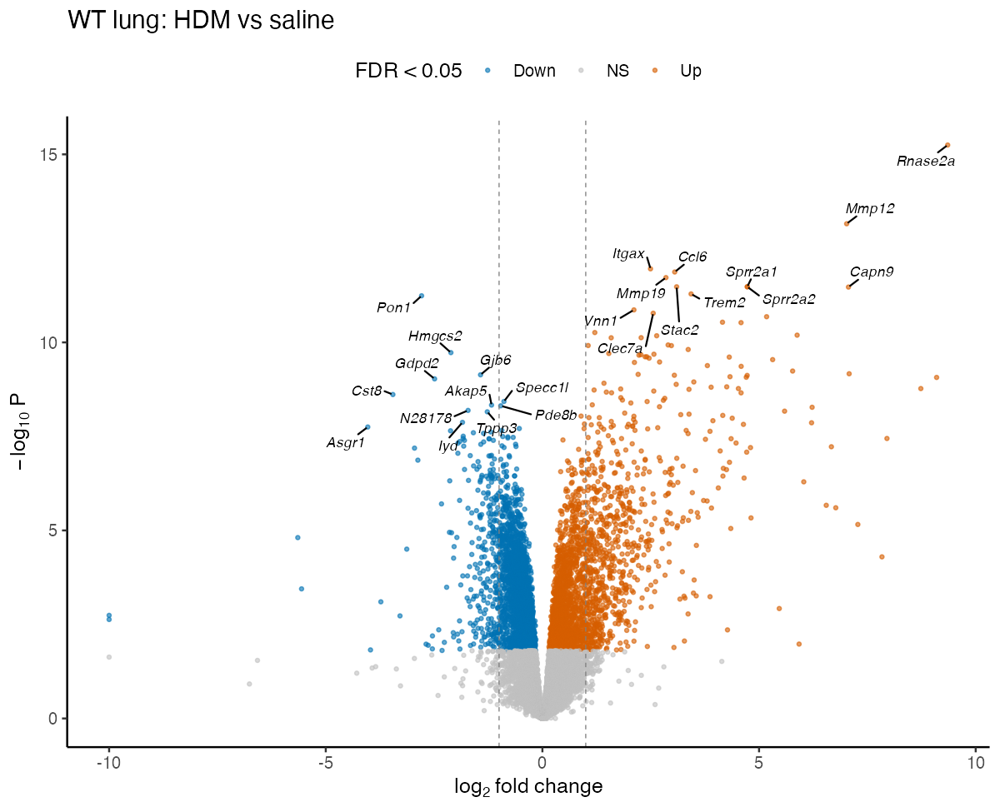

**[Read the analysis →](https://serenagall.github.io/bulk-rnaseq-showcase/)** · [Code on GitHub](https://github.com/SerenaGall/bulk-rnaseq-showcase)

A worked, fully reproducible bulk RNA-seq analysis of whole mouse lung. It uses public data from a 2 × 2 design: wild-type and ALOX15 knockout C57BL/6 mice challenged intranasally with house dust mite (HDM) or saline, five mice per group.

## Key findings

- HDM changes **over 5,000 genes** in wild-type lung, led by eosinophil (*Rnase2a*, ~650×), alternatively activated macrophage (*Chil4*, *Arg1*), mucosal mast cell (*Mcpt1*, *Mcpt2*) and goblet-cell (*Muc5ac*, *Clca3*) genes.
- The allergic response is **preserved without ALOX15** (fold changes correlate at r = 0.86). Knockout lungs show a stronger myeloid and interferon-inducible signature, flagged as a hypothesis because it is confounded with a processing batch.
- QC uncovered **four tissue contamination signals** (skeletal muscle, mediastinal brown fat, liver, blood). Two were modelled as covariates, which cut the biological coefficient of variation from 0.23 to 0.17. The other two were flagged. Genotype hits cluster on chromosome 11 around *Alox15*, the footprint of a 129-derived passenger interval.

## Methods

GEO import and annotation, library and tissue-contamination QC, `filterByExpr` and TMM normalisation, MDS/PCA with loading checks, a factorial edgeR quasi-likelihood GLM with contamination covariates, volcano/MA plots and grouped ComplexHeatmaps, directional KEGG ORA and GSEA (clusterProfiler), curated type 2 allergy gene panels, and interaction analysis with passenger-gene mapping. Written in R and published as a Quarto book with GitHub Actions.
