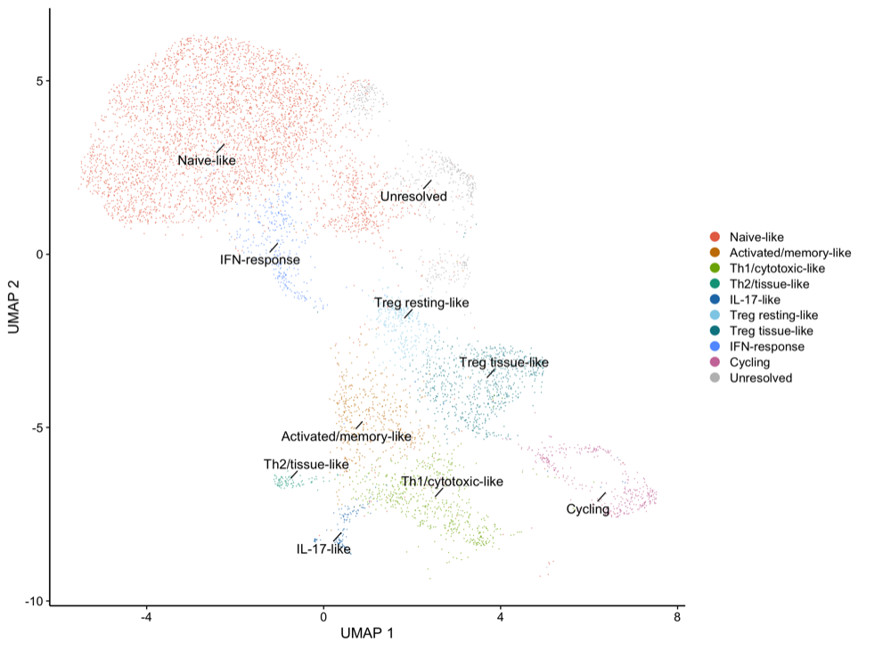

**[Read the analysis →](https://serenagall.github.io/tcr-scrnaseq-showcase/)** · [Code on GitHub](https://github.com/SerenaGall/tcr-scrnaseq-showcase)

A worked, fully reproducible analysis of single-cell RNA sequencing with paired T-cell receptor sequencing. It uses public 10x Genomics 5′ data from mouse lung CD4⁺ T cells, comparing a TNFR2 agonist with a control treatment (four mice per arm, 7,853 cells after QC).

## Key findings

- TNFR2 agonism expands **tissue-like regulatory T cells about five-fold** (3% → 16% of CD4⁺ T cells) and **cycling cells about four-fold**, consistently in every treated mouse.
- The Treg expansion is **polyclonal**: expanded TCR clones sit mainly in Th1/cytotoxic-like cells, not in Tregs.
- Treated mice show lower quiescence genes (*Bach2*, *Satb1*, *Klf2*) and a type I interferon response across states.

## Methods

Hashtag demultiplexing, DoubletFinder, SCTransform v2 and Harmony integration, Leiden clustering with a resolution sweep, curated state annotation, chain-aware clonotype reconstruction, mouse-level differential abundance (edgeR and Milo), pseudobulk differential expression, KEGG/Reactome/GO enrichment, and Slingshot/tradeSeq trajectories. Written in R (Seurat v5) and published as a Quarto book with GitHub Actions.
